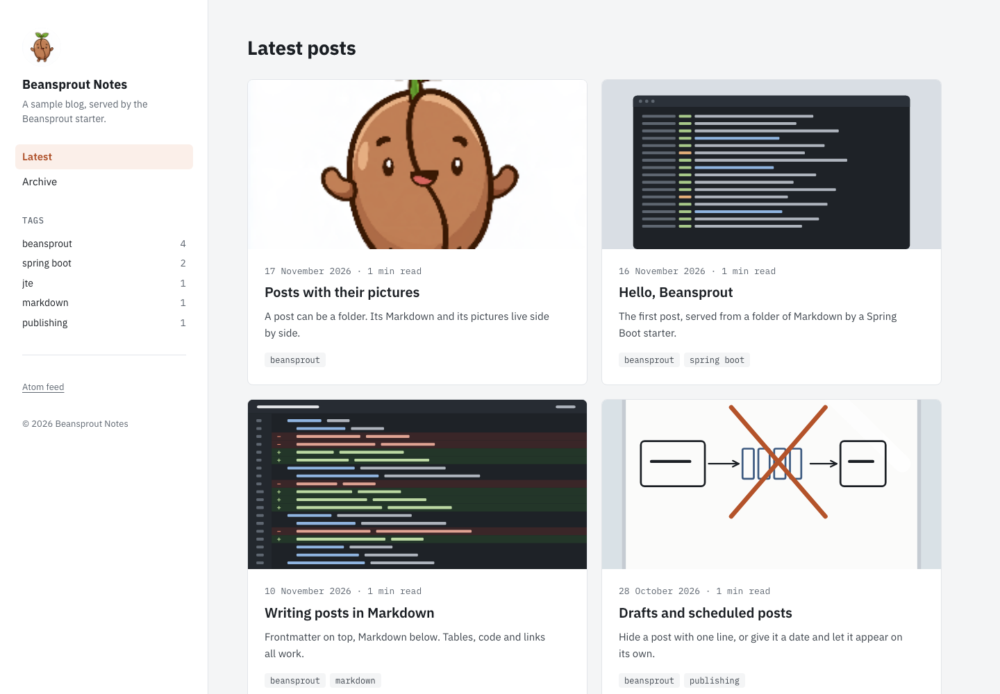
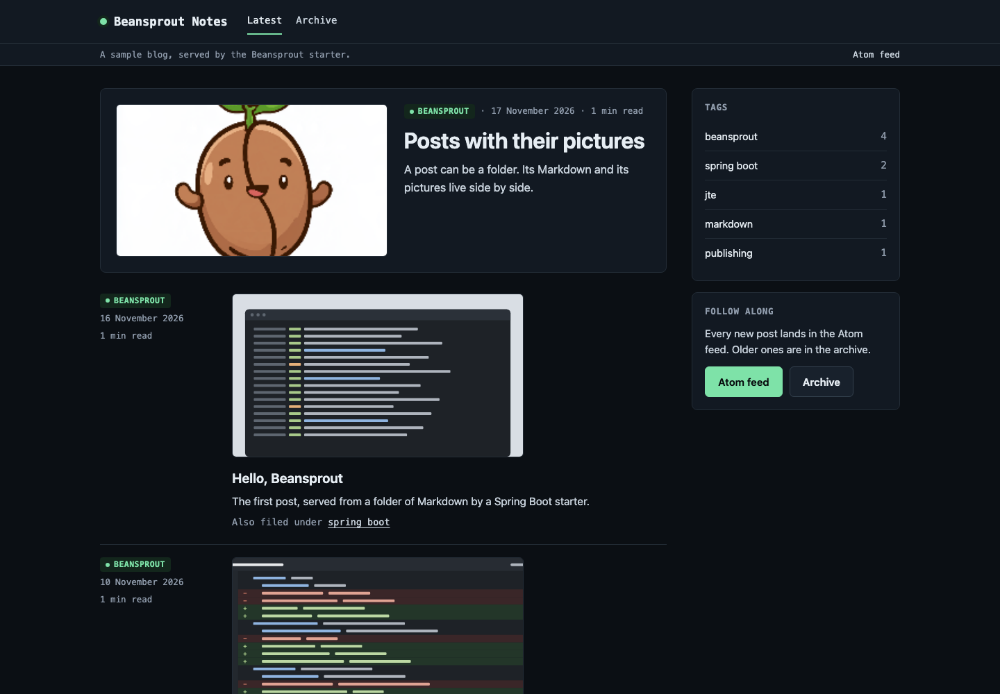
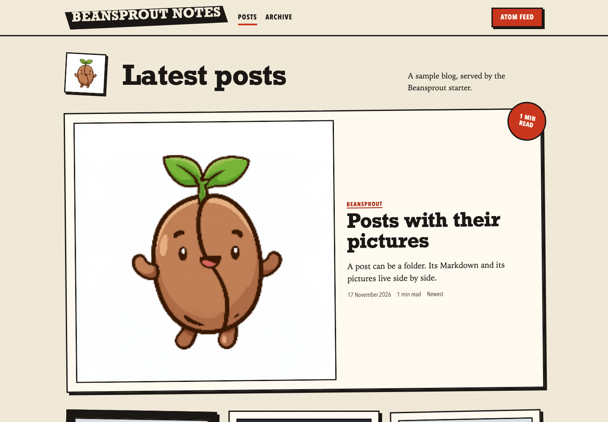
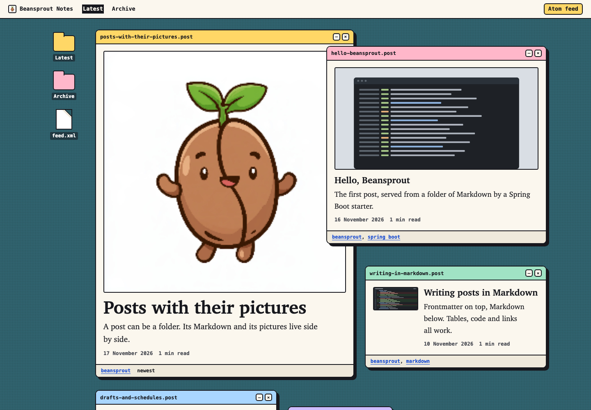
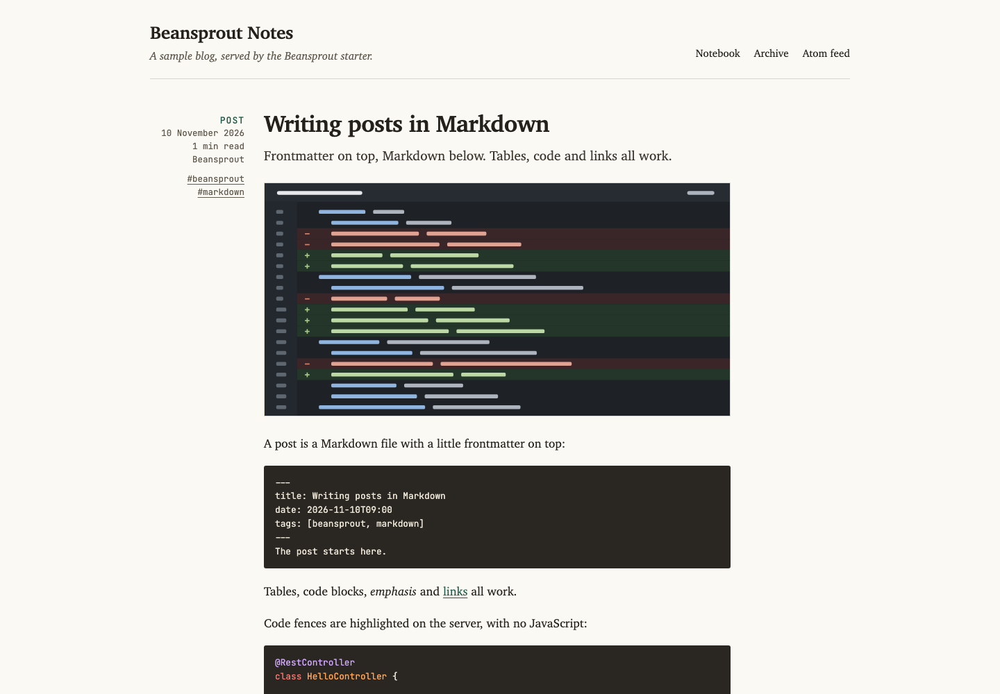

<p align="center">
  
</p>

<p align="center">
  <a href="https://central.sonatype.com/artifact/dev.danvega/beansprout-spring-boot-starter"></a>
  <a href="https://github.com/danvega/beansprout/actions/workflows/verify.yml"></a>
</p>

# Beansprout

Add a Markdown blog to the Spring Boot app you already run.

You write posts as Markdown files. Beansprout turns them into a blog inside your app: an index,
a page per post, tag pages, an archive, an Atom feed and a sitemap. Every page carries the tags
search engines and social sites read. Code is highlighted on the server. Pick one of eight free
themes, or use your own templates. No controllers, no database.

## Why

Java developers who want a blog today have two choices. Run a separate platform like Ghost or
WordPress next to their app, or build posts, tags, feeds and sitemaps by hand. Beansprout is
the third choice: add a dependency to the app you already have.

## Guides

- [Start a new blog](docs/new-blog.md): a new app, a theme, your first post, pictures, drafts and scheduling.
- [Deploy it](docs/deploy.md): to Railway, or anywhere that runs Java or Docker.
- [Publish as static files](docs/static-export.md): GitHub Pages, Netlify or Cloudflare Pages, with no Java host.
- [Use your own templates](docs/own-templates.md): your site's look instead of a theme.
- [Write with an agent over MCP](docs/mcp.md): let Claude Code or another agent read your posts and start drafts.
- [Search engines and AI crawlers](docs/search-engines.md): robots.txt, keeping AI training crawlers out, and ETags.

## Tested with

Java 25 and Spring Boot 4.1.2. Pages render with [JTE](https://jte.gg).

## Add it to your app

Import the BOM once, then add the starter and a theme with no version:

```xml
<dependencyManagement>
    <dependencies>
        <dependency>
            <groupId>dev.danvega</groupId>
            <artifactId>beansprout-bom</artifactId>
            <version>0.3.0</version>
            <type>pom</type>
            <scope>import</scope>
        </dependency>
    </dependencies>
</dependencyManagement>

<dependencies>
    <dependency>
        <groupId>dev.danvega</groupId>
        <artifactId>beansprout-spring-boot-starter</artifactId>
    </dependency>
    <dependency>
        <groupId>dev.danvega</groupId>
        <artifactId>beansprout-theme-longhand</artifactId>
    </dependency>
</dependencies>
```

With Gradle:

```kotlin
implementation(platform("dev.danvega:beansprout-bom:0.3.0"))
implementation("dev.danvega:beansprout-spring-boot-starter")
implementation("dev.danvega:beansprout-theme-longhand")
```

Put a post in `src/main/resources/posts/hello.md`:

```markdown
---
title: Hello, Beansprout
date: 2026-11-16
tags: [spring boot, java]
---
My first post.
```

Start your app and open `http://localhost:8080/blog`.

## Themes

Every theme is free. Swap the theme dependency to change the look.

Five of the themes come from [Pressworks](https://pressworks.dev), where they started as blog
templates. Thank you, Pressworks, for giving them to Beansprout. Plainsong, Onionskin and Calling
Card are Beansprout's own.

| Theme | Artifact | Look |
| --- | --- | --- |
| `longhand` | `beansprout-theme-longhand` | One writer, a long post with a picture. Light and dark. |
| `dateline` | `beansprout-theme-dateline` | An engineering blog dressed as a status board. Dark. |
| `linocut` | `beansprout-theme-linocut` | Bold and playful, black ink on warm paper with one red. |
| `marginalia` | `beansprout-theme-marginalia` | A link blog kept like a notebook. Short entries. |
| `small-machines` | `beansprout-theme-small-machines` | A lot of personality. The site is dressed as an old desktop. |
| `plainsong` | `beansprout-theme-plainsong` | A plain list of posts in black and white, no pictures. Light and dark. |
| `onionskin` | `beansprout-theme-onionskin` | Every post typed like a memo, in monospace. Light and dark. |
| `calling-card` | `beansprout-theme-calling-card` | You first: your name in poster-sized type, your photo, your topics. Light and dark. |

Here is the sample app's blog in each theme, with the same posts:

<table>
  <tr>
    <td width="50%"><br><b>Longhand</b></td>
    <td width="50%"><br><b>Dateline</b></td>
  </tr>
  <tr>
    <td width="50%"><br><b>Linocut</b></td>
    <td width="50%"><br><b>Small Machines</b></td>
  </tr>
  <tr>
    <td width="50%"><br><b>Marginalia</b>, a post</td>
    <td width="50%"></td>
  </tr>
</table>

With one theme on the classpath, Beansprout uses it. To keep several, name the one to use with
`beansprout.theme: dateline`. With two and no name, the app stops at startup and lists the
themes it found, rather than guessing. For your site's own look,
[use your own templates](docs/own-templates.md).

A post with `draft: true` stays hidden. A post dated in the future appears on that date, with no
redeploy. A post can also be a folder, `posts/hello/index.md`, with its pictures next to it.
Add `picture: cover.png` for a picture on the card and the post, and `updated: 2026-12-02` when
you change a post later.
[Start a new blog](docs/new-blog.md) has every frontmatter option.

## Settings

All optional, in `application.yaml`:

```yaml
beansprout:
  title: My Blog                    # default: Blog
  description: Notes on Java.       # default: empty
  author: Your Name                 # shown on each post. Default: empty
  photo: /images/me.png             # shown above the blog's name. Default: none
  theme: longhand                   # needed only with more than one theme. Default: the only one
  base-path: /blog                  # default: /blog
  page-size: 10                     # default: 10
  site-url: https://example.com     # for canonical links, previews, feed and sitemap. Default: the request
  time-zone: Europe/Amsterdam       # default: the server's zone
  posts:
    location: classpath:posts/      # or a folder on disk, like file:./posts/
    reload: false                   # true re-reads posts on every request, for development
  web:
    enabled: true                   # false turns the pages off. Posts and Pages stay as beans.
  code:
    highlight: true                 # false shows code fences as plain code
  robots:
    enabled: true                   # false serves no robots.txt. Off with a context path, or when the app has its own
    ai-training: allow              # block keeps AI training crawlers out of the blog. Search crawlers still read it
  mcp:
    token: ...                      # with the MCP starter: lets other machines call /mcp. Default: same machine only.
                                    # Keep it out of the repo: set BEANSPROUT_MCP_TOKEN instead
```

## Try the sample

The repo has a sample app with a few posts and every theme:

```bash
./mvnw -q install -DskipTests && ./mvnw -pl beansprout-sample spring-boot:run
```

Open `http://localhost:8080/blog`. To see another theme, add
`-Dspring-boot.run.arguments=--beansprout.theme=linocut` to the second command.

## How the project is laid out

| Module | What it does |
| --- | --- |
| `beansprout-core` | The blog's logic in plain Java. Reads Markdown into posts, decides what is published, builds the data for each page, writes the feed and sitemap. No Spring. |
| `beansprout-spring-boot-autoconfigure` | The Spring part. Reads the `beansprout.*` settings, creates the beans, and holds the controllers. |
| `beansprout-spring-boot-starter` | The dependency you add. It has no code of its own. |
| `themes/beansprout-theme-*` | The looks: each theme's templates and stylesheet, one module per theme. |
| `beansprout-mcp-spring-boot-starter` | Optional. Adds an MCP server so an agent can read posts and start drafts. It has no code. |
| `beansprout-bom` | One version for every artifact above. It has no code. |
| `beansprout-sample` | A small Spring Boot app that uses all of the above. |
| `verification` | Checks the build runs on the repo itself, such as no leftover TODOs in the code. |

Core has no Spring on purpose. A future MCP server or a static site export can reuse it without
a web server.

When someone opens `/blog/hello`:

1. `BlogController` takes the request.
2. `Pages` asks `Posts` for the post. `Posts` reads the Markdown and checks the post is published.
3. `Pages` returns a `PostPage`: plain text and lists, ready to show.
4. The theme turns it into HTML.

To read the code, start with
[Posts.java](beansprout-core/src/main/java/dev/danvega/beansprout/content/Posts.java) and
[Pages.java](beansprout-core/src/main/java/dev/danvega/beansprout/view/Pages.java).

## Build

You need JDK 25 or newer.

```bash
./mvnw verify
```

## License

Apache 2.0. See [LICENSE](LICENSE).
